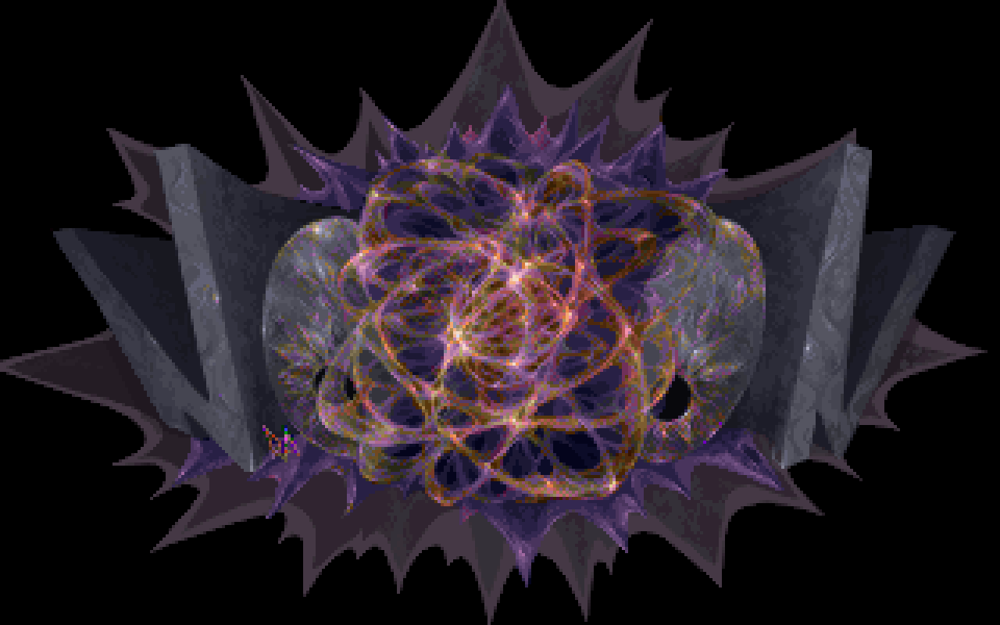

<p align="center"></p>

# STARS — JavaScript port of Noooon's 1995 MS-DOS demo

A reverse-engineered reimplementation of **STARS: Wonders of the world** (`STARSv2.EXE`, Noooon, 1995) in plain JavaScript: all effects redrawn in a 320×200 indexed-colour canvas, original music played through libopenmpt.

- **Play:** https://kassoulet.github.io/stars_by_nooon/ (landing page → demo)
- **Write-up:** [`web/writeup.html`](web/writeup.html) — how the EXE was unpacked and how each effect works.

## Run locally

```
python3 -m http.server -d web      # then open http://localhost:8000/
```

Click once to start (audio needs a gesture). Keys: **Space** pause · **←/→** seek ±5 s · **F** fullscreen.

## Layout

| Path | Content |
|---|---|
| `STARSv2.EXE` | the original demo (target); `STARS.EXE` is an older version, ignored |
| `web/` | the site: `index.html` (landing), `demo.html` + `main.js` (runner), `script.js` (timeline), `engine.js`, `lib3d.js`, `parts/*.js` (one module per effect), `assets/` (decompressed resources), `stars.xm` (music), `timeline.json` |
| `re/` | reverse-engineering: `NOTES.md` (process), `emu_unpack.py`, `dlz.py`, `extract.py`, `images.py`, `mod2xm.py`, `ref/harness.py` (Unicorn harness running the original code as ground truth), `parts/*.md` (per-effect notes) |

## Method (short)

Self-decrypting stub (emulated with Unicorn) → PKLITE-style LZ → flat 32-bit image (PMODE 3.07) → resource container with a custom `dlz` compressor. Each effect was disassembled, ported to JS and compared pixel by pixel with frames produced by the original code in the harness. See `re/NOTES.md`.

## Known gaps

- Part I's second half is not verified against the original; text-mode ending screen not ported.
- Parts assume one tick per frame (70 Hz); the original's animation speed may differ on slow frames.
- Random dots in the text part can't match the original exactly (seed depends on earlier parts).
- Seeking replays effects from the start of the current part, so a seeked frame can differ slightly from a normal run.
- Music is converted MOD → XM and played by libopenmpt, so mixing differs from the original LCA player.

## Credits

Original demo by **Noooon** (Groo: music, Bartie: 3D motion, Karl: system and effects, Ra: script and pixels), 1995. Sound: LCA player by Cedric Bermond; protected mode: PMODE by Tran. Playback: [libopenmpt](https://lib.openmpt.org/) via chiptune3. This port was produced by reverse engineering with AI assistance (Claude).
